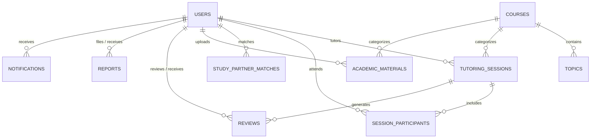

# 📘 CampusConnect Backend — Complete Step-by-Step Documentation Guide

> **Prepared for:** Team Documentation Officer / Report Writers  
> **Target Audience:** Non-technical and technical team members, project supervisors, and presentation evaluators  
> **Project:** CampusConnect (StudyConnect) — Peer-to-Peer Student Academic Support Platform  
> **Interactive API Playground:** `http://localhost:3000/docs` (Swagger UI)  
> **Source Code Repository:** [github.com/samuelbukumni/campusconnect](https://github.com/samuelbukumni/campusconnect)

---

## 📑 Table of Contents
1. [What is CampusConnect? (The Real-World Picture)](#1-what-is-campusconnect-the-real-world-picture)
2. [Why We Built It (The Campus Problem)](#2-why-we-built-it-the-campus-problem)
3. [The Technology Stack in Plain English](#3-the-technology-stack-in-plain-english)
4. [Step-by-Step Implementation Breakdown (What Was Built)](#4-step-by-step-implementation-breakdown-what-was-built)
   - [Step 1: System Foundation & Setup](#step-1-system-foundation--setup)
   - [Step 2: Student Registration, OTP & Login (AuthModule)](#step-2-student-registration-otp--login-authmodule)
   - [Step 3: Student Profiles & Dual Roles (UsersModule)](#step-3-student-profiles--dual-roles-usersmodule)
   - [Step 4: Course Catalog & Smart Topic Search (CoursesModule)](#step-4-course-catalog--smart-topic-search-coursesmodule)
   - [Step 5: Tutoring Bookings & Scheduling (TutoringModule)](#step-5-tutoring-bookings--scheduling-tutoringmodule)
   - [Step 6: Peer Study Partner Matching & Reshuffling (PartnersModule)](#step-6-peer-study-partner-matching--reshuffling-partnersmodule)
   - [Step 7: Academic Materials Hub & Downloads (MaterialsModule)](#step-7-academic-materials-hub--downloads-materialsmodule)
   - [Step 8: Ratings, Reviews & Tutor Reputation (ReviewsModule)](#step-8-ratings-reviews--tutor-reputation-reviewsmodule)
   - [Step 9: Campus Safety & Disciplinary Reporting (ReportsModule)](#step-9-campus-safety--disciplinary-reporting-reportsmodule)
   - [Step 10: In-App Notifications & Badges (NotificationsModule)](#step-10-in-app-notifications--badges-notificationsmodule)
   - [Step 11: Real-Time Logging & Unified Error Handling](#step-11-real-time-logging--unified-error-handling)
   - [Step 12: Scope Refinement (Why Attendance Was Dropped)](#step-12-scope-refinement-why-attendance-was-dropped)
5. [Database Architecture & Data Relationships](#5-database-architecture--data-relationships)
6. [How to Test the System & Take Screenshots (Swagger UI)](#6-how-to-test-the-system--take-screenshots-swagger-ui)
7. [Plain-English Glossary of Technical Terms](#7-plain-english-glossary-of-technical-terms)

---

## 1. What is CampusConnect? (The Real-World Picture)

**CampusConnect** is a peer-to-peer university academic mobile/web application designed to connect students who need academic assistance in difficult courses with fellow students who excel in those subjects.

Unlike traditional commercial tutoring platforms that hire external professional teachers, CampusConnect leverages the **existing talent on campus**:
- A 300-level Computer Science student who struggles with **MTH 102 (Calculus)** might be an expert in **CSC 201 (Python & Algorithms)**.
- On CampusConnect, that student can **receive tutoring** for Calculus while simultaneously **giving tutoring** in Python.

---

## 2. Why We Built It (The Campus Problem)

Every semester, tertiary students face four major academic hurdles:
1. **Large Lecture Halls:** In classes with 200–500 students, lecturers cannot provide one-on-one attention to struggling students.
2. **Hidden Peer Talent:** Brilliant seniors or classmates who understand difficult topics have no organized way to offer help.
3. **Unstructured Study Groups:** Students often form reading groups that collapse due to incompatible study schedules or lack of commitment.
4. **Scattered Study Materials:** Past exam question solutions and summarized lecture notes are lost across scattered WhatsApp and Telegram chats.

CampusConnect solves all four problems by centralizing **tutoring bookings**, **study partner matching**, **past question sharing**, and **verified ratings** in one reliable system.

---

## 3. The Technology Stack in Plain English

Here is the tech stack used to build the backend, explained without confusing jargon:

| Tool / Technology | What It Is | Why We Used It |
| :--- | :--- | :--- |
| **NestJS** | Modern Node.js Backend Framework | Organizes our code into neat, isolated modules (`auth`, `courses`, `tutoring`, etc.) so everything is clean and easy to maintain. |
| **TypeScript** | Strongly Typed JavaScript | Prevents coding errors before the app even runs by catching typos and mismatched data early. |
| **PostgreSQL** | Relational SQL Database | A rock-solid database that safely stores students, courses, sessions, and reviews with relationships connecting them together. |
| **TypeORM** | Object-Relational Mapper (ORM) | Allows our TypeScript code to talk directly to PostgreSQL tables using TypeScript classes instead of writing raw SQL strings everywhere. |
| **Resend** | Official Email Service API | Sends real-time 6-digit OTP verification codes directly to students' university email inboxes within 1 to 2 seconds. |
| **JWT (JSON Web Token)** | Secure Digital ID Badge | After logging in, a student receives an encrypted digital token. Their phone/browser presents this token to access protected endpoints. |
| **Swagger / OpenAPI** | Interactive API Playground | Automatically creates a live web page at `http://localhost:3000/docs` where anyone can view, test, and document all endpoints without Postman. |

---

## 4. Step-by-Step Implementation Breakdown (What Was Built)

Here is the chronological, step-by-step process of how the entire backend was built:

---

### Step 1: System Foundation & Setup
- **What was done:** Initialized the NestJS application with a strict folder architecture.
- **Where it lives:** `src/main.ts`, `src/app.module.ts`, `src/config/`.
- **How it works:**
  - Configured typed environment loaders (`.env`) for database credentials, port numbers, and JWT secrets.
  - Set a global API route prefix: all endpoints start with `/api/v1/` for clean versioning.
  - Configured Cross-Origin Resource Sharing (CORS) so frontend applications (React, Flutter, or Next.js) can connect seamlessly.

---

### Step 2: Student Registration, OTP & Login (`AuthModule`)
- **What was done:** Built the full student onboarding and security engine.
- **Where it lives:** `src/modules/auth/`.
- **How it works (Student Experience):**
  1. **Registration:** Student submits their email, password, name, department, level, and matric number.
  2. **Security:** Passwords are encrypted using one-way cryptographic hashing (`bcryptjs`) before touching the database. Plain passwords are never stored.
  3. **6-Digit OTP Email:** The system generates a cryptographically random 6-digit code, saves it with a 10-minute expiry time, and emails it to the student via **Resend**.
  4. **Cooldown Rate Limiting:** A 60-second cooldown prevents abuse or spamming of the resend OTP button.
  5. **Verification & Activation:** Once the student types the OTP, their account status changes to `isVerified = true`, and they receive their first JWT access token.
  6. **Login & Session:** Existing students log in with email and password to receive a JWT token, or use `GET /api/v1/auth/me` to instantly load their current logged-in profile.

---

### Step 3: Student Profiles & Dual Roles (`UsersModule`)
- **What was done:** Implemented student account management and the dual-role architecture.
- **Where it lives:** `src/modules/users/`.
- **How it works:**
  - Each student can hold one of four roles: `LEARNER`, `TUTOR`, `BOTH`, or `ADMIN`. By default, university students are set to `BOTH`.
  - Profile attributes include: bio, profile photo link (`avatarUrl`), phone number, department, academic level (e.g. 100L, 200L, 300L), matric number, and arrays of `coursesToTeach` and `coursesNeedingHelp`.
  - Dynamically tracks: `rating` (e.g. 4.85 stars), `reviewCount`, `totalSessionsGiven`, and `totalSessionsAttended`.

---

### Step 4: Course Catalog & Smart Topic Search (`CoursesModule`)
- **What was done:** Built the academic syllabus directory and search engine.
- **Where it lives:** `src/modules/courses/`.
- **How it works:**
  - Stores university courses with their official code (e.g., `MTH 102`, `CSC 201`, `PHY 101`), title, department, and credit units.
  - Each course breaks down into granular syllabus topics (e.g., under `MTH 102`: *Integration by Parts*, *Differential Equations*, *Limits & Continuity*).
  - **Keyword Search:** Students can search for anything: course codes, course titles, or even specific subtopics (`GET /api/v1/courses/search?q=integration`).
  - **Live Demand Metrics:** Every course card automatically computes how many verified tutors are available vs. how many learners are seeking help, identifying high-demand courses across campus.
  - **Seed Endpoint:** Includes a pre-populated test catalog endpoint (`POST /api/v1/courses/seed`) that seeds 6 standard university courses and 18 topics for instant testing.

---

### Step 5: Tutoring Bookings & Scheduling (`TutoringModule`)
- **What was done:** Implemented 1-on-1 and group tutorial scheduling with full lifecycle tracking.
- **Where it lives:** `src/modules/tutoring/`.
- **How it works:**
  1. **Booking:** A learner books a session by specifying:
     - The tutor's ID and course ID.
     - Scheduled date & time (e.g., Friday at 2:00 PM).
     - Session format: `PHYSICAL` (e.g., "Faculty of Science Library, Study Carrel 4") or `ONLINE` (e.g., Google Meet link).
     - Session type: `ONE_ON_ONE` or `GROUP` (with custom capacity limit, e.g. up to 6 students).
  2. **Joining Group Sessions:** Other students can browse open upcoming group tutorials (`GET /api/v1/tutoring/group/open`) and click to join directly until the session reaches maximum capacity.
  3. **Status Lifecycle:** Tracks session states:
     - `SCHEDULED`: Waiting for tutor confirmation.
     - `CONFIRMED`: Tutor accepts the date, time, and venue.
     - `COMPLETED`: Tutorial successfully took place.
     - `CANCELLED`: Cancelled by either party with a recorded reason.

---

### Step 6: Peer Study Partner Matching & Reshuffling (`PartnersModule`)
- **What was done:** Created an intelligent matching system for peers who want study buddies.
- **Where it lives:** `src/modules/partners/`.
- **How it works:**
  - A student requests a study partner for a course (e.g., `CSC 201`) with their preferred format (`PHYSICAL`, `ONLINE`, or `BOTH`).
  - The matching engine pairs them with an eligible, verified student on campus studying that course.
  - **Reshuffling Workflow:** If a study partner is inactive, non-responsive, or has an incompatible timetable, either student can request a reshuffle (`POST /api/v1/partners/:id/reshuffle`). The current match is safely marked `RESHUFFLED`, and the system immediately attempts to pair the student with a new peer.

---

### Step 7: Academic Materials Hub & Downloads (`MaterialsModule`)
- **What was done:** Built an academic resource sharing vault for campus study materials.
- **Where it lives:** `src/modules/materials/`.
- **How it works:**
  - Tutors and students upload study aids tagged by course, syllabus topic, and material category:
    - `LECTURE_NOTES`
    - `PAST_QUESTIONS`
    - `SLIDES`
    - `LAB_REPORT`
  - Students can browse, filter by category or topic, and search keywords.
  - **Download Tracking:** Every time a student downloads a material (`POST /api/v1/materials/:id/download`), the system increments its `downloadsCount` counter and returns the file link.
  - **Ownership Protection:** Only the original uploader or an administrator can delete a shared file.

---

### Step 8: Ratings, Reviews & Tutor Reputation (`ReviewsModule`)
- **What was done:** Built a quality assurance and peer review engine.
- **Where it lives:** `src/modules/reviews/`.
- **How it works:**
  - Once a tutoring session reaches `COMPLETED` status, attendees can leave a review with a 1-to-5 star rating and written testimonial.
  - **Verification Safeguards:**
    - Only students who actually attended the session can leave a review.
    - Each student can only review a completed session once (no duplicate review spam).
  - **Automatic Reputation Calculation:** Upon submission, the backend automatically recalculates the tutor's overall average rating (e.g., `4.85 / 5.0`) and total review count, instantly updating the tutor's public profile card.

---

### Step 9: Campus Safety & Disciplinary Reporting (`ReportsModule`)
- **What was done:** Implemented student safety, accountability, and incident reporting.
- **Where it lives:** `src/modules/reports/`.
- **How it works:**
  - If a user encounters misconduct, harassment, a no-show, academic dishonesty, or scam attempts, they can file a report (`POST /api/v1/reports`).
  - Students cannot report themselves, and every report links to the reported student and optionally the tutoring session.
  - **Admin Resolution Workflow:** University administrators can view all campus incident reports (`GET /api/v1/reports`) and transition their status:
    - `PENDING` ➔ `INVESTIGATING` ➔ `RESOLVED` or `DISMISSED` (with official administrator review notes).

---

### Step 10: In-App Notifications & Badges (`NotificationsModule`)
- **What was done:** Real-time in-app alert and notification tracking system.
- **Where it lives:** `src/modules/notifications/`.
- **How it works:**
  - Automatically notifies students when:
    - A tutoring session is booked, confirmed, or cancelled.
    - A study partner is matched or reshuffled.
    - A new review is posted on their tutoring profile.
    - An incident report status is updated.
  - Provides an unread badge counter endpoint (`GET /api/v1/notifications/unread-count`) so mobile/web apps can show the red notification badge (e.g., `(3)` unread).
  - Supports marking individual notifications as read or bulk "Mark All as Read".

---

### Step 11: Real-Time Logging & Unified Error Handling
- **What was done:** Added professional terminal request logging and global exception interception.
- **Where it lives:** `src/common/middleware/http-logger.middleware.ts`, `src/common/filters/http-exception.filter.ts`, `src/common/interceptors/transform.interceptor.ts`.
- **How it works:**
  1. **HTTP Logger Middleware:** Every incoming request and outgoing response is printed to the server terminal with its HTTP method, URL, status code, client IP, and execution latency in milliseconds (`+42ms`).
  2. **Unified Error Structure:** If any endpoint fails, `AllExceptionsFilter` catches it and returns a clean, predictable JSON error instead of crashing or leaking raw stack traces:
     ```json
     {
       "success": false,
       "statusCode": 404,
       "message": "Tutoring session with ID not found",
       "path": "/api/v1/tutoring/book",
       "timestamp": "2026-10-23T00:30:00.000Z"
     }
     ```
  3. **Unified Success Structure:** `TransformInterceptor` packages all successful operations into:
     ```json
     {
       "success": true,
       "statusCode": 200,
       "message": "Operation successful",
       "data": { ... },
       "timestamp": "2026-10-23T00:30:00.000Z"
     }
     ```

---

### Step 12: Scope Refinement (Why Attendance Was Dropped)
- **What was decided:** Per team and supervisor direction, the standalone **attendance taking** module was eliminated.
- **Why this makes the project stronger:**
  - In a peer-to-peer student setting, manual QR code/geofenced attendance check-ins added unnecessary friction.
  - Accountability is already naturally enforced: when a tutor marks a session `COMPLETED`, attendees must confirm it before leaving their 1–5 star review and testimonial.
  - Eliminating it simplified the database and removed 2 redundant tables.

---

## 5. Database Architecture & Data Relationships

All tables inherit from `BaseEntity` (`id` as UUID primary key, `createdAt`, `updatedAt`).



### Table Summary:
1. **`users`**: Student profiles, passwords (hashed), contact info, department, level, rating, reviewCount.
2. **`otps`**: 6-digit email verification codes, expiresAt timestamp, attempt counters.
3. **`courses`**: Course catalog (`MTH 102`, `CSC 201`, etc.), department, credit units.
4. **`topics`**: Specific syllabus topics belonging to courses.
5. **`tutoring_sessions`**: Booked tutorials, dates, locations (physical venue or meet URL), status, maxLearners.
6. **`session_participants`**: Students who joined a specific tutoring session.
7. **`study_partner_matches`**: Pairings between Student A and Student B for a specific course, status (`ACTIVE` / `RESHUFFLED`).
8. **`academic_materials`**: Shared lecture notes, past exam questions, file URLs, and download counters.
9. **`reviews`**: 1-to-5 star ratings and testimonials tied to completed sessions and tutors.
10. **`reports`**: Incident/misconduct reports with admin resolution notes.
11. **`notifications`**: In-app student alerts with unread flags and deep link metadata.

---

## 6. How to Test the System & Take Screenshots (Swagger UI)

If you need screenshots for your project documentation, thesis writeup, or slide presentation:

1. **Start the backend locally:**
   ```bash
   npm run start:dev
   ```
2. **Open your browser and visit:**
   👉 **`http://localhost:3000/docs`**
3. **What you will see:**
   - A clean, interactive Swagger documentation interface.
   - All modules clearly labeled with tags:
     - `Health`
     - `Authentication`
     - `Users / Students`
     - `Courses & Topics Catalog`
     - `Tutoring Sessions`
     - `Study Partners`
     - `Academic Materials`
     - `Reviews & Testimonials`
     - `Disciplinary & Safety Reports`
     - `In-App Notifications`
4. **Testing an endpoint live:**
   - Click any endpoint (e.g. `POST /api/v1/courses/seed`).
   - Click **Try it out** ➔ **Execute**.
   - You will see the live server response with HTTP `200 OK` and formatted JSON data.

---

## 7. Plain-English Glossary of Technical Terms

Use this cheat-sheet when writing the project report or answering supervisor questions during defense:

| Term | Simple Definition | Everyday Analogy |
| :--- | :--- | :--- |
| **API (Application Programming Interface)** | A bridge that allows the mobile/web frontend to talk to the backend database. | A waiter in a restaurant who takes your order from the table to the kitchen and brings back your food. |
| **Endpoint / Route** | A specific URL address on the server that handles one task (e.g. `/api/v1/auth/register`). | A specific counter at a bank (e.g. Counter 1 for deposits, Counter 2 for withdrawals). |
| **HTTP Methods (`GET`, `POST`, `PATCH`, `DELETE`)** | The action being requested: `GET` (fetch data), `POST` (create new data), `PATCH` (update existing data), `DELETE` (remove data). | Read, Write, Edit, Erase. |
| **JWT (JSON Web Token)** | An encrypted string that proves a student is logged in. | A digital stamp or wristband given at an event entrance so you don't have to show your ID card every time. |
| **Bcrypt Hashing** | A mathematical one-way scramble that transforms passwords into unreadable code. | Passing a document through a paper shredder; you cannot un-shred it, but you can verify if a new document matches. |
| **DTO (Data Transfer Object)** | A strict rulebook defining what fields a student is allowed to send in a form. | A passport application form with required fields; if you leave required boxes blank, the officer rejects it. |
| **Entity / Model** | A blueprint that defines a database table and its columns in code. | The architectural drawing of a spreadsheet table. |
| **Middleware** | Code that runs on every request before it reaches the endpoint (e.g. logging). | A security guard at a building gate who writes down every visitor's name and entry time in a ledger. |
| **Rate Limiter (Throttler)** | A safety mechanism that limits how many times an endpoint can be hit per minute. | A turnstile that prevents 500 people from rushing through a single door at the same second. |
| **Unit Test** | An automated script that verifies whether a function behaves correctly. | A quality control test in a factory that checks if a car brake works before the car leaves the assembly line. |
